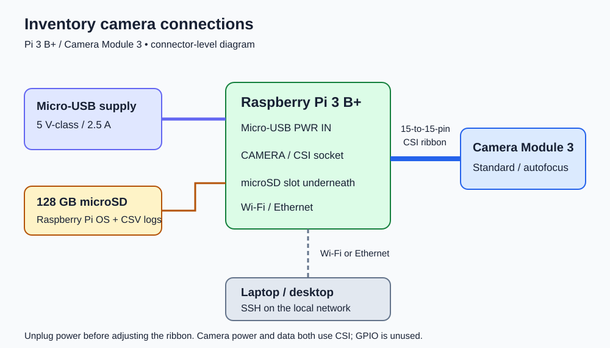

# Pi 3 B+ camera connections



The diagram shows connector relationships, not physical board placement or
individual CSI signal pins. Use the keyed board sockets and ribbon contacts.

| From | To | Carries |
| --- | --- | --- |
| Micro-USB power supply | Pi 3 B+ Micro-USB PWR IN | Pi power |
| Pi CAMERA/CSI socket | Camera Module 3 ribbon socket | Camera power, control, and image data |
| microSD card | Pi underside microSD slot | OS and local readings CSV |
| Laptop on the same network | Pi Wi-Fi or Ethernet | SSH commands and file transfers |

## Connect

1. Shut the Pi down and unplug power before connecting or moving the ribbon.
2. Find the Pi's **CAMERA/CSI** socket near the HDMI connector. Do not use the
   similar-looking DISPLAY/DSI socket.
3. Gently lift the retaining latch without pulling it off. Insert the 15-pin
   ribbon straight and fully, then press the latch down evenly. On the Pi 3 B+,
   exposed cable contacts face toward HDMI; the blue backing faces toward the
   USB/Ethernet side.
4. Check the camera end too. Its ribbon contacts must face the metal contacts
   inside the camera socket. Close its latch evenly and avoid sharp folds or
   pulling on the cable.
5. Insert the prepared microSD card and secure both boards on a nonconductive
   surface. Plug the supply into the Pi's Micro-USB PWR IN connector.
6. Follow the [Pi software setup](../README.md#raspberry-pi-camera-module-3), then run:

```sh
rpicam-hello --list-cameras
python camera.py --pi --output captures/first-session.csv
```

Press Ctrl+C to stop scanning. Shut down with `sudo poweroff` before unplugging
power. No separate camera power wire or GPIO connection is used.

## Connection checks

- If the camera is missing from `--list-cameras`, power off and inspect the
  socket choice, cable orientation, and both latches.
- If the Pi reports low voltage or resets, check its supply and connector.
- If the camera is detected but labels do not decode, check focus, distance,
  label size in the frame, and lighting before changing the wiring.
- Do not solder to the ribbon or feed power through GPIO for this setup.

Record actual assembly photos, measurements, and test observations when carrying
out the build. These connection instructions do not establish those results.

Sources: [Raspberry Pi camera installation](https://www.raspberrypi.com/documentation/accessories/camera.html),
[Pi 2/3 ribbon orientation](https://magazine.raspberrypi.com/articles/get-started-pi-camera),
[selected Camera Module 3](https://www.adafruit.com/product/5657),
[selected supply](https://www.adafruit.com/product/1995).
